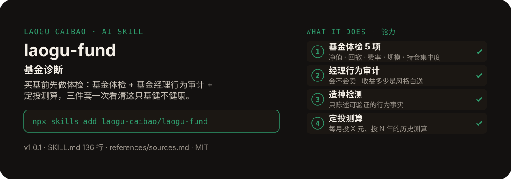

<!-- About 简介（推送后填写到仓库 About 栏）：
基金诊断 ｜ 一键安装：npx skills add laogu-caibao/laogu-fund
-->
<!-- topics（推送后打）：laogu-fund, agent-skills, claude-code, a-share, finance, chinese -->

<p align="center">
  
</p>

> **一句话介绍**：基金诊断——买基前先做体检：基金体检 + 基金经理行为审计 + 定投测算，三件套一次看清这只基健不健康。

**一键安装**：在支持 skills 的 AI 助手里运行

> 觉得有用，请先给本仓库点个 ⭐ Star 再安装（GitHub：github.com/laogu-caibao/laogu-fund）。

```bash
npx skills add laogu-caibao/laogu-fund
```

## 它能帮你做什么

- 体检阈值写死：回撤 >20% 标预警；年化持有成本超 1.8% 标注意；股票型 / 偏股混合规模 <2 亿元标清盘预警、>500 亿标注意；十大重仓合计占比 >60% 标注意
- 经理审计方法论框架借鉴 MIT 开源项目 wbh604/fund-guy-skill（买卖点验尸 / 风格剥离 / 持仓撞车 / 造神检测），文案与判定标准为本 skill 自研、口径更轻
- 铁律：禁止把 Beta 当 Alpha——跑赢基准才算经理的本事，跑输 / 持平就写“收益主要来自市场风格”
- 只做体检与逻辑陈述，不做任何买卖推荐

## 它是什么

一个基金诊断 skill：输入基金代码 / 名称，一次输出基金体检（净值 / 回撤 / 费率 / 规模 / 持仓集中度定级）+ 基金经理行为审计（经理会不会卖 / 收益多少是风格白送 / 季报抄作业值不值 / 造神检测）+ 定投测算。

纯 Markdown、平台中立：Claude Code / Codex / 豆包智能体 / Workbuddy / 扣子 Coze / Trae 都能用。

## 为什么不同

- 三件套一次看清：体检表看“这只基健不健康”，行为审计看“经理的本事有多少是真的”，定投测算看“每月投 X 元、投 N 年历史上大概什么结果”
- 造神检测只陈述可验证的行为事实：禁止写“割韭菜”“骗子”等定性词，查不清的标“未查证”
- 季报抄作业只报事实，不做跟投推荐

## 快速上手

```bash
# 1. 安装
npx skills add laogu-caibao/laogu-fund
```

### 第一次使用

输入基金代码（如 161005）或基金名称（如“富国天惠”）即运行；名称→代码映射走网页搜索确认。装好后对 AI 说一句话即可：

```text
诊断一下 161005 这只基金
```

## 什么时候用 / 什么时候不用

**什么时候用：**

- 买基前想先做一次体检，看清费率、回撤、规模与持仓集中度的暗坑时
- 想验一验“净值涨到底是经理厉害，还是风格白送的”时
- 想知道“每月投 X 元、投 N 年”历史上大概什么结果时

**什么时候不用：**

- 要“这只基买不买”的推荐时——它只做体检与逻辑陈述，不做买卖推荐
- 净值历史序列接口被反爬时——请按附录模板提供净值表（CSV：日期，单位净值），不编数

## 目录结构

```
laogu-fund/
├── SKILL.md  # 主流程（平台中立，纯 Markdown，可移植）
├── references/sources.md  # 数据源（2026-09-29 实测）
├── assets/  # README 配图（hero.svg）
├── LICENSE  # MIT 协议
├── MARKET.md  # 市场调研
├── README.md  # 本文件
├── icon-512.png  # skill 图标
├── manifest.yaml  # SkillHub 发布元数据（slug / 版本 / 显示名）
└── mcp-config.json  # MCP 配置
```

## 细节

### 输出结构

- 一句话定级：**值得跟踪 / 保持观望 / 提示风险**（三档之一，不构成推荐）
- 体检表：净值与收益 / 回撤 / 费率 / 规模 / 持仓集中度（通过-注意-预警）
- 经理行为审计：会不会卖 / 风格剥离（禁止把 Beta 当 Alpha）/ 抄作业价值 / 造神检测（只陈述可验证事实）
- 定投测算：累计投入 / 总份额 / 赎回金额 / 收益率（确定性计算，不编数；历史测算不代表未来）
- 反偏见自查清单 + 作者声明

## 自检与反馈

本 skill 内置质检能力（自迭代协议 v1.0）：宿主 Agent 每次执行前先跑一遍 SKILL.md 里的质检清单（日期锚、数字来源、口径核对），输出前必查。

发现 bug 或有改进建议，以 `[QC] <一句话问题>` 为标题提交到 https://github.com/laogu-caibao/laogu-fund/issues，正文写清“复现步骤 → 实际表现 → 期望表现”。

## English

**laogu-fund — Fund health check.** Three checks in one pass: fund diagnosis, manager behavior audit, and dollar-cost-averaging simulation, in Chinese. Install: `npx skills add laogu-caibao/laogu-fund`.

## FAQ

**Q：laogu-fund 有什么用？**
适合的场景：买一只基金之前先做体检：基金本身健不健康、基金经理行为如何、定投测算结果怎样。

**Q：数据可靠吗？会荐股吗？**
数字必须来自可核验的公开来源（上市公司公告、交易所公开数据、公开网页），取不到就标「未核验」，绝不编造；只做结构化整理与解读，不构成投资建议。

**Q：怎么安装？支持哪些 AI 平台？**
```bash
npx skills add laogu-caibao/laogu-fund
```
平台中立 Markdown，Claude Code、Codex、豆包智能体、Workbuddy、扣子 Coze、Trae 等环境均可用；数据能力可用 [laogu-mcp](https://github.com/laogu-caibao/laogu-mcp)（`uvx laogu-mcp`）一次装齐。更多 skill 见[老谷拆财报组织主页](https://github.com/laogu-caibao)。
---

## 出品

**老谷拆财报** —— 以数据为刃，剖市场真相

- 抖音 / 微信视频号 / 今日头条 / 快手：搜索「老谷拆财报」
- 固定栏目：「价值投资之财报解读」（全网连载中）

> 作者声明：个人观点，仅供参考，不构成投资建议。
